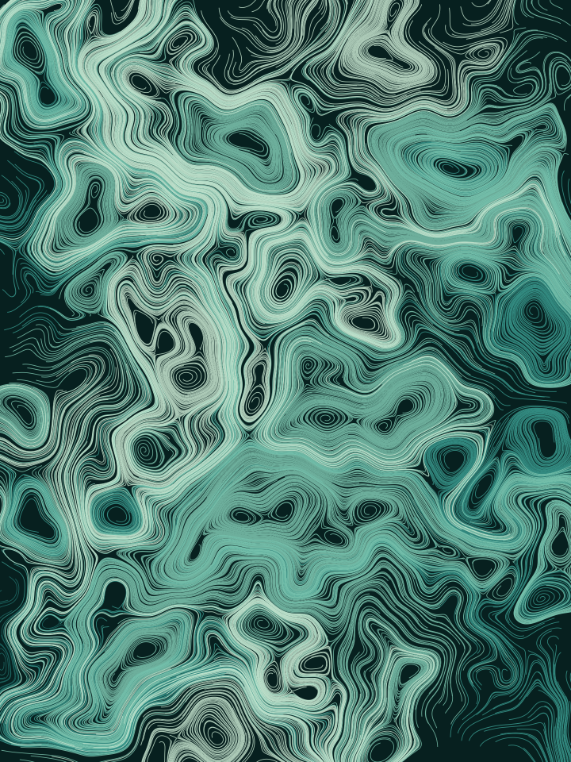
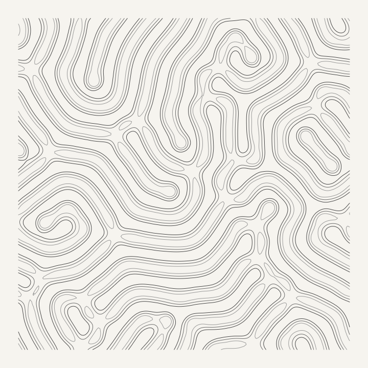
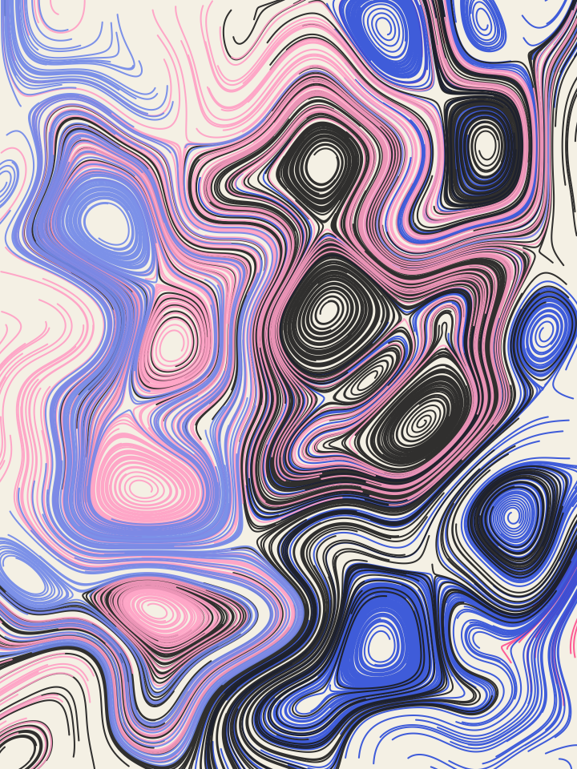
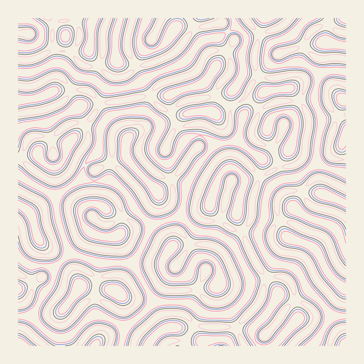
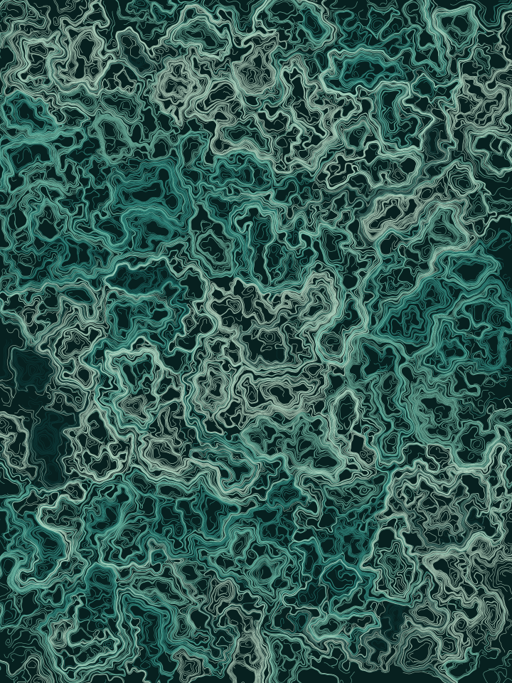
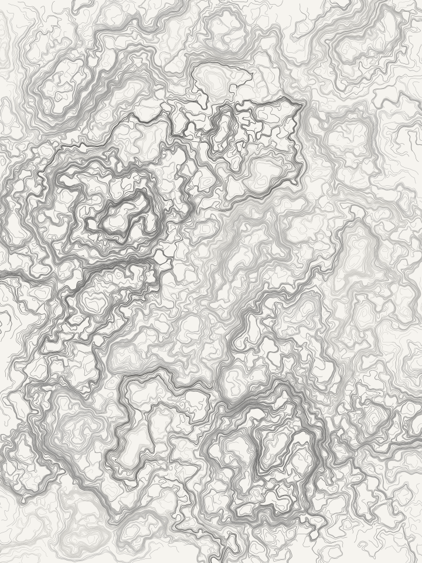
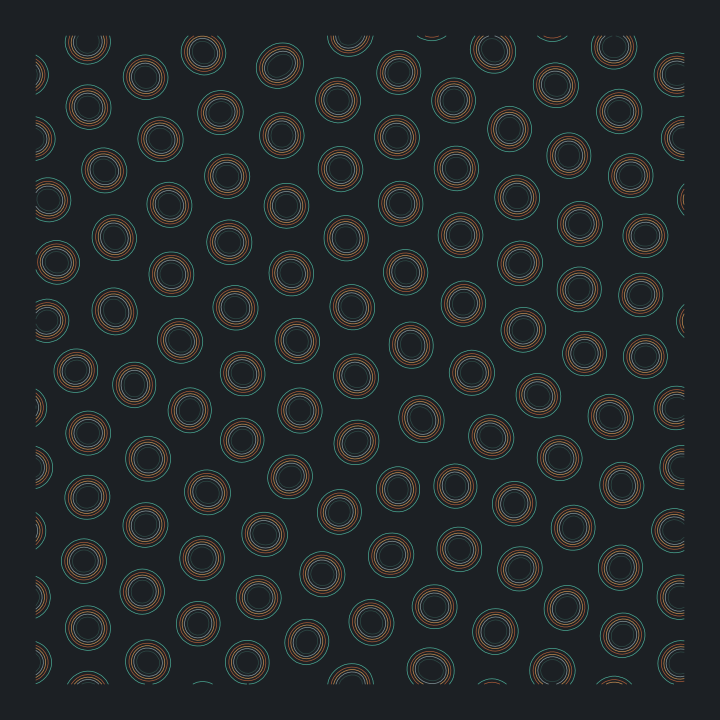
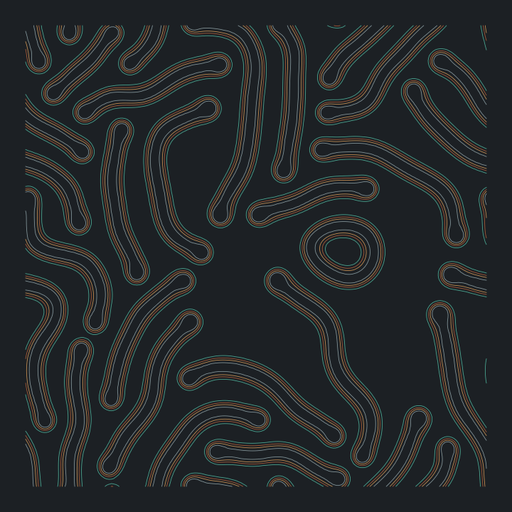

# fieldwork

**Deterministic generative art.** Two algorithms — flow fields and reaction-diffusion —
reduced to vector line work. A seed and a set of parameters always produce the same
image, byte for byte, on any machine.

<p align="center">
  
  
</p>

<p align="center">
  <a href="https://shell-mp3.github.io/fieldwork/"><strong>Open the playground →</strong></a>
  ·
  <a href="gallery/README.md">Full gallery</a>
</p>

---

## Why I built this

I wanted a project where "it works" is not a matter of opinion. Generative art is
usually the opposite: you tweak until it looks nice, and nothing is verifiable.

So I made reproducibility the actual requirement. Every random choice runs through one
seeded generator. No `Math.random`, no `Date.now`, no platform floating-point surprises
— and no `node:zlib` in the PNG encoder, because its output is deterministic in
practice but not by contract. The result is testable in a way art normally isn't: CI
regenerates all twelve gallery images on every push and fails if a single byte moves.

The pleasant side effect is that a piece is a URL. Every image here is fully described
by its seed and parameters, which is why the gallery stores 720px previews rather than
full-resolution files — the command under each piece recreates the original exactly.

## Quickstart

```bash
npm install
npm run cli -- render --algo flow --seed harbour-drift --palette kelp --out art.svg
```

```bash
npm run dev          # playground at localhost:5173
npm run check        # typecheck + lint + 115 tests
npm run gallery      # regenerate every gallery image from the manifest
```

## Gallery

<table>
  <tr>
    <td width="33%"><br><sub><b>Press Check</b> · flow · <code>riso</code></sub></td>
    <td width="33%"><br><sub><b>Coral Bloom</b> · reaction · <code>riso</code></sub></td>
    <td width="33%"><br><sub><b>Undertow</b> · flow · <code>kelp</code></sub></td>
  </tr>
  <tr>
    <td><br><sub><b>Foolscap</b> · flow · <code>graphite</code></sub></td>
    <td><br><sub><b>Mitosis</b> · reaction · <code>oxide</code></sub></td>
    <td><br><sub><b>Worms</b> · reaction · <code>oxide</code></sub></td>
  </tr>
</table>

[All twelve pieces, with the command to reproduce each →](gallery/README.md)

## How it works

Both algorithms produce the same thing — a `Scene` of coloured polylines — so there is
exactly one SVG renderer, one rasteriser and one canvas renderer rather than one of each
per algorithm.

```
          seed ──► mulberry32 ──► everything below is a pure function
                        │
       ┌────────────────┴────────────────┐
       ▼                                 ▼
  flow field                      reaction-diffusion
  simplex noise                   Gray-Scott on a torus
  → curl → advect particles       → marching squares contours
       │                                 │
       └────────────┬────────────────────┘
                    ▼
                 Scene { layers: [{ colour, width, paths }] }
                    │
       ┌────────────┼────────────┬──────────────┐
       ▼            ▼            ▼              ▼
     SVG        rasteriser     canvas      (metadata in
  + RDP simplify    │        (playground)   SVG desc and
                    ▼                        PNG tEXt)
              PNG encoder
          (own deflate, no zlib)
```

**Flow fields.** Particles ride the *curl* of a fractal simplex noise field rather than
using the noise value as an angle. Curl of a scalar potential is divergence-free, so
paths crowd and braid but never collapse into sinks — that is where the marbled look
comes from. Spawn points are stratified on a jittered grid, because purely random
spawning clumps and leaves bald patches at a few thousand particles.

**Reaction-diffusion.** Gray-Scott, two chemicals, 9-point Laplacian with wraparound
edges. Clamped edges grow a visible rectangular scar, so the simulation lives on a
torus. The settled field is then contoured with marching squares into polylines — which
is what lets it share a renderer with the flow fields instead of needing 40,000 `<rect>`
elements.

**Determinism**, enforced in four places:

| Where | What it pins |
| --- | --- |
| `test/determinism.test.ts` | Golden SHA-256 hashes for four seed/renderer combinations |
| `test/reaction.test.ts` | The optimised inner loop matches the reference Laplacian bit for bit |
| `test/render.test.ts` | Our DEFLATE round-trips through `node:zlib`'s inflater |
| `.github/workflows/ci.yml` | Regenerates all 12 gallery images; fails on any byte change |

## CLI

```bash
fieldwork render --algo <flow|reaction> --seed <string> --out <file.svg|file.png>
fieldwork palettes      # the four palettes and what they came from
fieldwork params flow   # every parameter, its default and its range
fieldwork --help
```

Output format follows the extension. `--scale 2` supersamples PNG output; `--no-simplify`
keeps every point in the SVG. Omit `--seed` and one is generated and printed, so an
accident is still reproducible.

Palettes are `kelp`, `riso`, `oxide` and `graphite` — defined in
[`src/palettes.json`](src/palettes.json), each credited to what it was taken from. Add
one by adding an object to that file; nothing else needs to change.

## What I learned / tradeoffs

> Draft — rewrite this section in your own words before publishing.

**Writing the PNG encoder was the right call, and it cost 20%.** Using `node:zlib` would
have been three lines. But a determinism guarantee that depends on the host's zlib build
isn't a guarantee, and zlib-ng has shifted output before. So the repo has its own DEFLATE:
greedy LZ77 over a 32 KiB window with fixed Huffman tables. Measured against `zlib`
level 9 on a real piece, it produces files **20% larger** (1805 KB vs 1507 KB). Dynamic
Huffman tables would close most of that gap; I chose ~200 auditable lines over the extra
complexity, and the tests verify the bitstream by round-tripping it through zlib's
*inflater* — the one direction where depending on zlib is safe.

**A profile beat a guess.** The reaction-diffusion inner loop runs ~230 million cells at
the defaults. It called a `laplacian()` helper that did four modulo operations per cell.
Hoisting the wrap arithmetic into precomputed tables and inlining the two Laplacians cut
a render from 4.6s to 2.9s (**1.6x**) with byte-identical output. I kept the original
function as the readable reference and added a test asserting the fast path still matches
it exactly — the optimisation is only safe because that test exists.

**A test caught a bug I would have shipped.** Marching squares emits zero-length segments
when a sample sits exactly on the threshold, which happens constantly with integer-valued
fields and any circle passing through a 6-8-10 lattice point. Those degenerate points
appear in the stitching map as extra ends and split one clean contour into fragments. The
test asking "two blobs should be two paths" returned ten. Real reaction-diffusion fields
are floating point and almost never hit it, so this would have sat in the code invisibly.

**What I would not do again:** the playground regenerates on every control change, and a
reaction-diffusion piece takes several seconds even after the optimisation. A progressive
preview — simulate at a quarter resolution while dragging, full resolution on release —
would be much better than a spinner and an apology.

**Not implemented:** dynamic Huffman tables; interlaced or palette PNG; GPU/WebGL
simulation; animation or frame export; any colour space beyond sRGB hex.

## Licence

MIT. The palettes are inspired by physical references credited in `src/palettes.json`;
the colour values themselves are mine to give away.
