# Gallery

<!-- Generated by `npm run gallery` from manifest.json. Do not edit by hand. -->

12 pieces. Each PNG below is committed at 720px wide;
the full-resolution SVG is not committed because it does not need to be — the
command under each piece reproduces it byte for byte.

### Harbour Drift

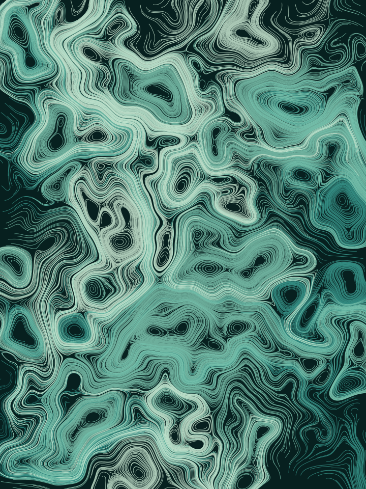

Long braided channels. The classic flow field look.

**flow** · seed `harbour-drift` · palette `kelp` — _Pacific kelp forest at 20 m, where green has already gone and only blue is left_

[Open in the playground](https://shell-mp3.github.io/fieldwork/#preset=harbour-drift) · reproduce at full resolution:

```bash
fieldwork render --algo flow --seed harbour-drift --palette kelp --particles 2600 --steps 460 --noiseScale 0.0016 --octaves 3 --out 01-harbour-drift.svg
```

### Tidewrack

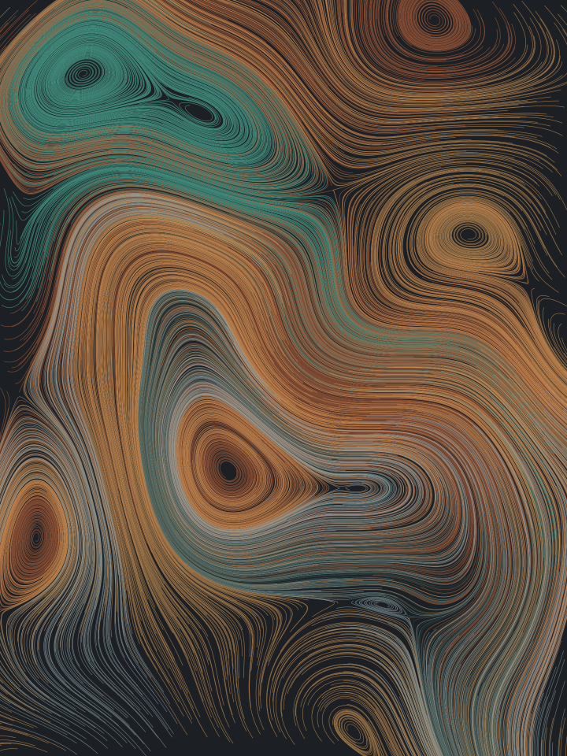

A very low field scale: lazy, wide currents that cross the whole canvas.

**flow** · seed `tidewrack-88` · palette `oxide` — _Weathered copper roofing: verdigris creeping over rust on a wet slate day_

[Open in the playground](https://shell-mp3.github.io/fieldwork/#preset=tidewrack) · reproduce at full resolution:

```bash
fieldwork render --algo flow --seed tidewrack-88 --palette oxide --particles 3200 --steps 700 --stepLength 1.8 --noiseScale 0.0007 --octaves 2 --lineWidth 1 --opacity 0.7 --out 02-tidewrack.svg
```

### Foolscap

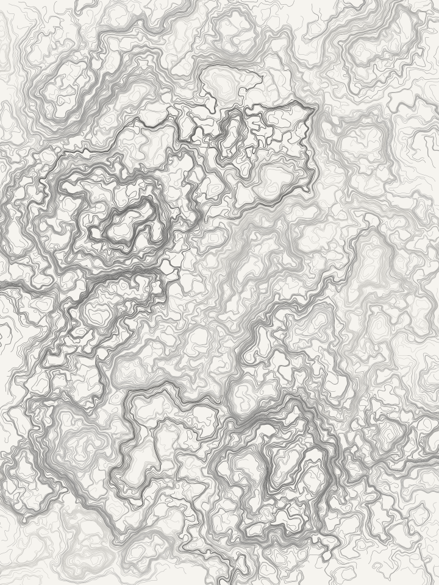

Five octaves of noise, hairline strokes. Dense and papery.

**flow** · seed `foolscap` · palette `graphite` — _2B pencil on tracing paper, held up to a window_

[Open in the playground](https://shell-mp3.github.io/fieldwork/#preset=foolscap) · reproduce at full resolution:

```bash
fieldwork render --algo flow --seed foolscap --palette graphite --particles 2400 --steps 380 --noiseScale 0.0022 --octaves 5 --lineWidth 0.8 --opacity 0.75 --colorScale 0.0012 --out 03-foolscap.svg
```

### Press Check

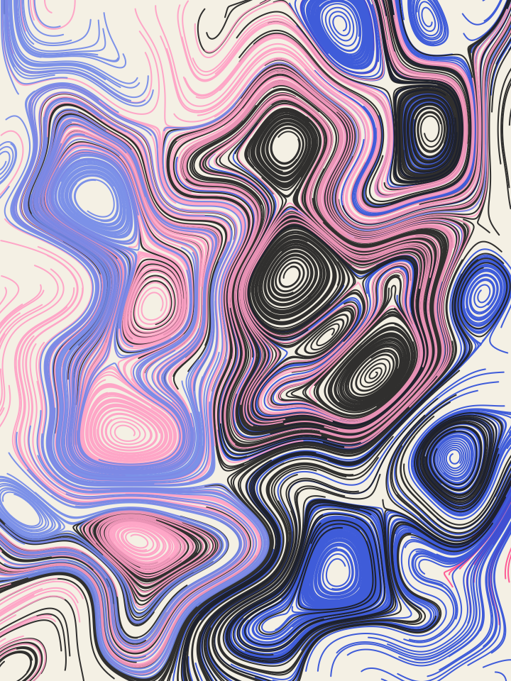

Few particles, thick strokes. Reads as printed ink rather than line work.

**flow** · seed `press-check-2` · palette `riso` — _Two-colour risograph print on uncoated stock, fluorescent pink over blue_

[Open in the playground](https://shell-mp3.github.io/fieldwork/#preset=press-check) · reproduce at full resolution:

```bash
fieldwork render --algo flow --seed press-check-2 --palette riso --particles 850 --steps 520 --stepLength 3 --noiseScale 0.0012 --octaves 2 --lineWidth 3.4 --opacity 0.9 --out 04-press-check.svg
```

### Undertow

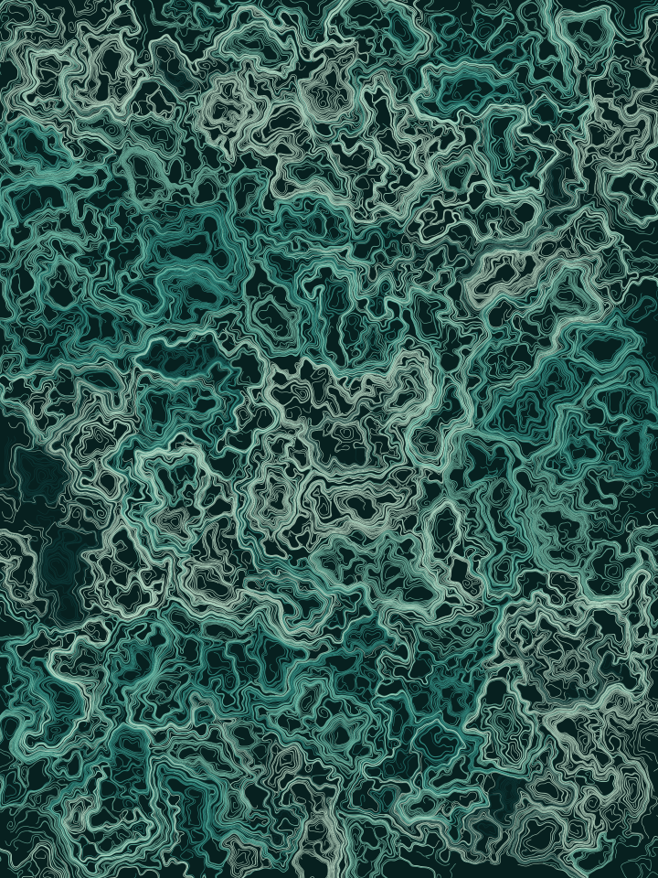

High field scale: tight turbulence instead of long channels.

**flow** · seed `undertow-419` · palette `kelp` — _Pacific kelp forest at 20 m, where green has already gone and only blue is left_

[Open in the playground](https://shell-mp3.github.io/fieldwork/#preset=undertow) · reproduce at full resolution:

```bash
fieldwork render --algo flow --seed undertow-419 --palette kelp --particles 3600 --steps 300 --stepLength 1.6 --noiseScale 0.0042 --octaves 4 --lineWidth 1 --opacity 0.8 --colorScale 0.0018 --out 05-undertow.svg
```

### First Frost

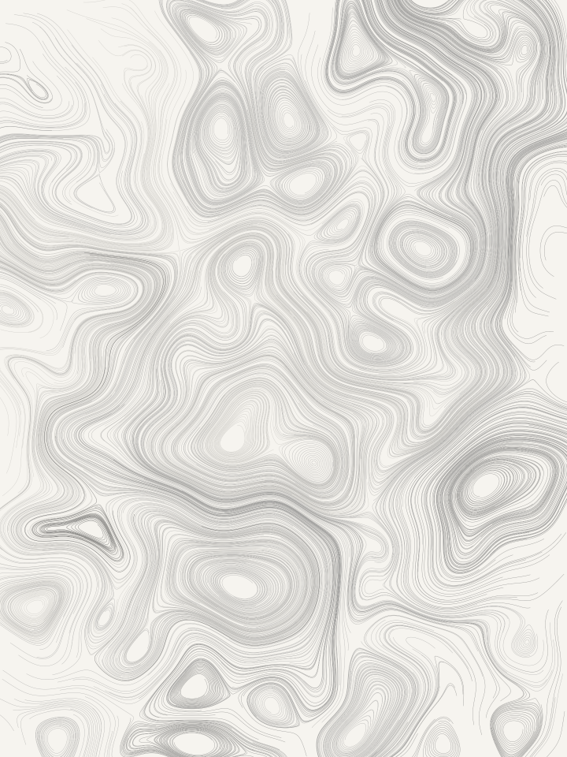

Long runs, short steps, a high minimum length. Only the survivors are drawn.

**flow** · seed `first-frost` · palette `graphite` — _2B pencil on tracing paper, held up to a window_

[Open in the playground](https://shell-mp3.github.io/fieldwork/#preset=first-frost) · reproduce at full resolution:

```bash
fieldwork render --algo flow --seed first-frost --palette graphite --particles 1400 --steps 1100 --stepLength 1.2 --noiseScale 0.0009 --octaves 3 --lineWidth 0.6 --opacity 0.85 --minLength 120 --out 06-first-frost.svg
```

### Coral Bloom

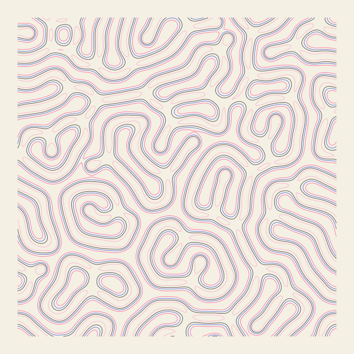

Gray-Scott in its coral-growth regime.

**reaction** · seed `coral-7` · palette `riso` — _Two-colour risograph print on uncoated stock, fluorescent pink over blue_

[Open in the playground](https://shell-mp3.github.io/fieldwork/#preset=coral-bloom) · reproduce at full resolution:

```bash
fieldwork render --algo reaction --seed coral-7 --palette riso --gridSize 200 --iterations 11000 --feed 0.0545 --kill 0.062 --contours 4 --lineWidth 1.4 --out 07-coral-bloom.svg
```

### Mitosis

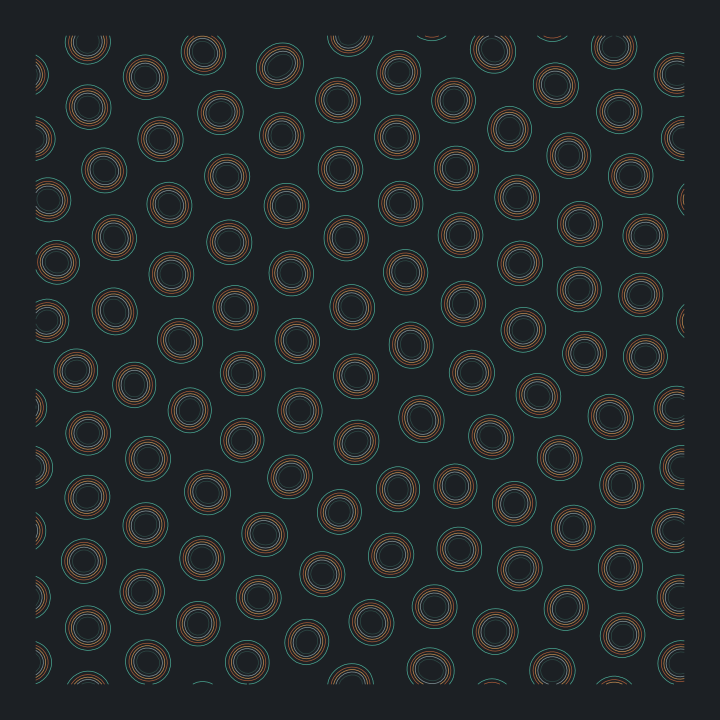

Feed and kill tuned so blobs grow and divide.

**reaction** · seed `1842` · palette `oxide` — _Weathered copper roofing: verdigris creeping over rust on a wet slate day_

[Open in the playground](https://shell-mp3.github.io/fieldwork/#preset=mitosis) · reproduce at full resolution:

```bash
fieldwork render --algo reaction --seed 1842 --palette oxide --gridSize 190 --iterations 14000 --feed 0.0367 --kill 0.0649 --contours 5 --seedSpots 26 --out 08-mitosis.svg
```

### Labyrinth

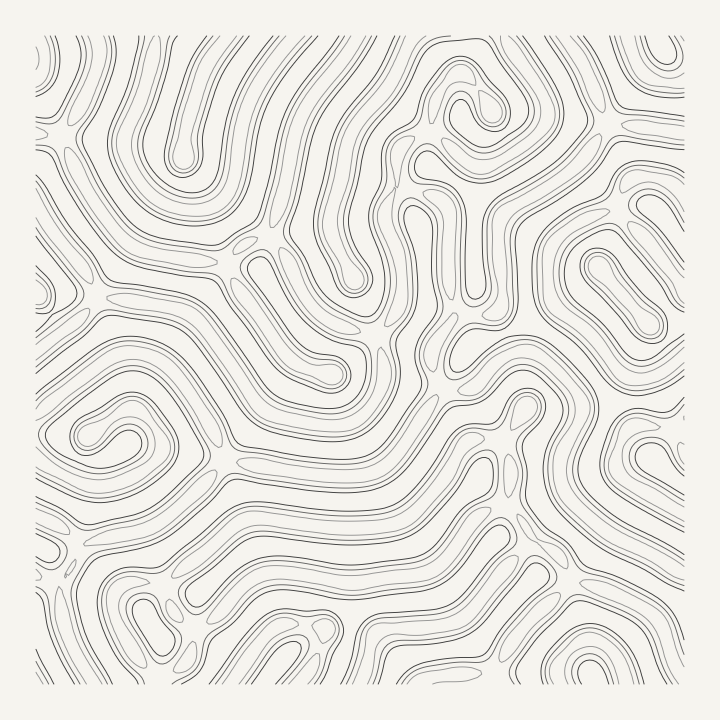

The maze regime: long parallel corridors that never quite close.

**reaction** · seed `labyrinth-3` · palette `graphite` — _2B pencil on tracing paper, held up to a window_

[Open in the playground](https://shell-mp3.github.io/fieldwork/#preset=labyrinth) · reproduce at full resolution:

```bash
fieldwork render --algo reaction --seed labyrinth-3 --palette graphite --gridSize 200 --iterations 12000 --feed 0.029 --kill 0.057 --contours 3 --lineWidth 1.6 --seedSpots 30 --out 09-labyrinth.svg
```

### Solitons

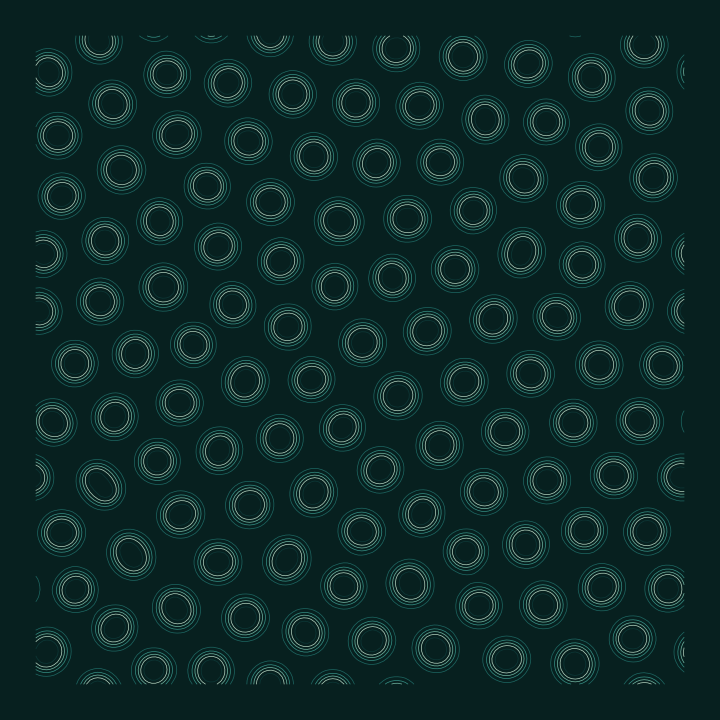

Isolated spots that hold their shape indefinitely.

**reaction** · seed `solitons-x` · palette `kelp` — _Pacific kelp forest at 20 m, where green has already gone and only blue is left_

[Open in the playground](https://shell-mp3.github.io/fieldwork/#preset=solitons) · reproduce at full resolution:

```bash
fieldwork render --algo reaction --seed solitons-x --palette kelp --gridSize 180 --iterations 10000 --feed 0.03 --kill 0.062 --contours 5 --seedSpots 22 --out 10-solitons.svg
```

### Worms

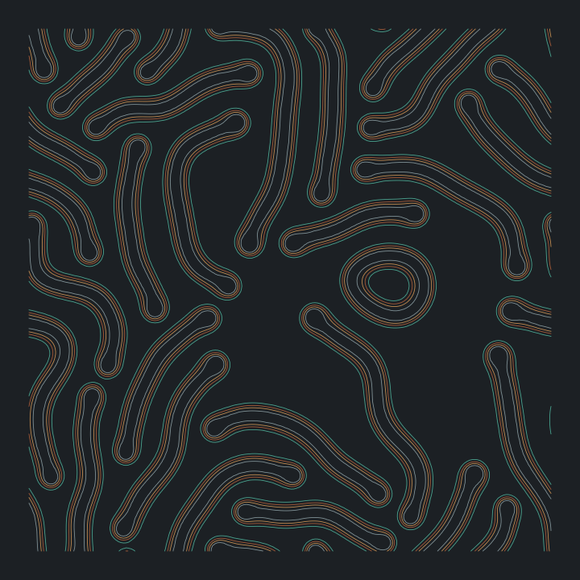

A high feed rate: wandering filaments that branch.

**reaction** · seed `worms-61` · palette `oxide` — _Weathered copper roofing: verdigris creeping over rust on a wet slate day_

[Open in the playground](https://shell-mp3.github.io/fieldwork/#preset=worms) · reproduce at full resolution:

```bash
fieldwork render --algo reaction --seed worms-61 --palette oxide --gridSize 200 --iterations 9000 --feed 0.078 --kill 0.061 --contours 4 --lineWidth 1.4 --seedSpots 34 --out 11-worms.svg
```

### U-Skate

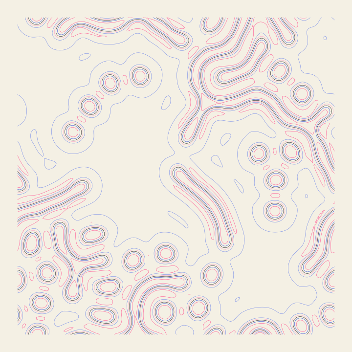

U-Skate world. Gliders that drift and collide.

**reaction** · seed `u-skate-world` · palette `riso` — _Two-colour risograph print on uncoated stock, fluorescent pink over blue_

[Open in the playground](https://shell-mp3.github.io/fieldwork/#preset=u-skate) · reproduce at full resolution:

```bash
fieldwork render --algo reaction --seed u-skate-world --palette riso --gridSize 190 --iterations 13000 --feed 0.062 --kill 0.0609 --contours 6 --lineWidth 1.1 --seedSpots 16 --out 12-u-skate.svg
```

